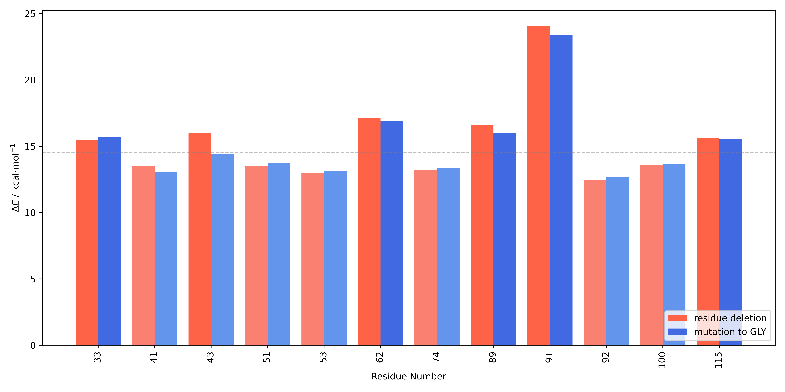

 

<h2>
 <b>Mutagenesis Scan</b> 
 </h2>

<b>This protocol is designed to perform a mutagenesis scan with residues such as ALA or GLY (other residues are also allowed). The mutated residues are optimized while keeping the rest of the system fixed, and then single-point calculations are performed on the provided reactant and transition state structures. </b>

<b>The protocol requires the following inputs:</b>
 
● File listing the residues to be mutated
 
● Topology file in *prmtop format
 
● Reactant and transition state structures in *pdb format
 
● LEaP and CP2K input templates
 
● Selection of the QM region
 
 
<b>Additionally, the following software packages are needed:</b>
 
● CP2K
 
● PyMOL
 
● VMD
 
● CPPTRAJ (from AmberTools)
 
● LEaP (from AmberTools)
 
● ParmEd (from AmberTools)
 
● Python 3 with Matplotlib (for the plots)

---

 
<h2> 
 <b>I - Input Preparation </b> 
</h2>

 

To properly construct the QM system, a selection in the format of qm_selection.dat is required. Note that atom numbers will change upon mutation, while residue IDs (resid's) remain the same. The preparation of the selection is explained in the I - Input Preparation section of the <a href="https://arvpinto.github.io/enzyme_mutagenesis_cp2k/residue_deletion.html" target="_blank">residue deletion protocol</a>.

 

The <a href="https://arvpinto.github.io/enzyme_mutagenesis_cp2k/scripts/mut_scan_qmmm_cp2k.sh" target="_blank">mut_scan_qmmm_cp2k.sh</a> script has the following usage:

<pre style="color: white; background-color: black;">
mut_scan_qmmm_cp2k.sh [options] &lt;residue_list&gt; &lt;scan_type&gt; &lt;topology&gt; &lt;reactant_structure&gt; &lt;ts_structure&gt; &lt;selection&gt; &lt;leap_template&gt; &lt;cp2k_template&gt; &lt;qm_selection&gt;

user@machine:~$ mut_scan_qmmm_cp2k.sh scan_list.dat GLY hpla2_ee.prmtop R.pdb TS.pdb :1-124 leap_template.in cp2k_template.inp qm_selection.dat
</pre>

It prepares a directory for each residue in the list where the input files for CP2K will be output, and a WT directory with the single-points of the unmodified system. The &lt;scan_type&gt; argument represents the three-letter code of the residue used in the scan. ALA and GLY are suitable for assessing sidechain contributions, whereas residues with greater volume and more degrees of freedom may complicate the analysis. Note: when mutating a CYX residue in a disulfide bridge, the other CYX is converted to CYS and is optimized together with the mutated residue. The &lt;selection&gt; argument defines the residue range of the enzyme, which has to be the first block of atoms of the topology (its parameters are updated, while the rest of the system remains unchanged). The cp2k_template.inp file is used to produce geometry optimization and single-point energy input files. The scan_summary.dat file reports what was done to each residue.

The LEaP input has to load the same force field that was used for the original topology (the sample topology was built with ff99SB-ILDN, hence the <code>source oldff/leaprc.ff99SBildn</code> line of the sample leap_template.in). The scripts verify this: if the atom types of the residues that were not mutated differ from the original topology the mutant is not built. In addition, the charges and Lennard-Jones parameters of all the residues that were not mutated are copied from the original topology, so that changes made to it after LEaP (e.g. charges of residues at the QM/MM boundary, or Lennard-Jones parameters of hydroxyl hydrogens) are kept, and the mutant differs from the wild type only in the mutated residue.

 

To generate the structures and topology of the mutated enzyme, the <a href="https://arvpinto.github.io/enzyme_mutagenesis_cp2k/scripts/build_mutant.sh" target="_blank">build_mutant.sh</a> script is called by the mut_scan_qmmm_cp2k.sh script and has the following syntax:

<pre style="color: white; background-color: black;">
build_mutant.sh [options] &lt;mut_name&gt; &lt;topology&gt; &lt;reactant_structure&gt; &lt;ts_structure&gt; &lt;selection&gt; &lt;leap_template&gt; &lt;mutation&gt; [&lt;mutation&gt; ...]
</pre>

 

Since mutating residues changes the atom numbering, the QM/MM settings must be updated for each mutation. The <a href="https://arvpinto.github.io/enzyme_mutagenesis_cp2k/scripts/qmmm_mut_tools.py" target="_blank">qmmm_mut_tools.py</a> script is called by the mut_scan_qmmm_cp2k.sh script to check how the mutated residue should be included in the QM layer and modify the qm_selection.dat file accordingly (the parts of the backbone and of the sidechain that were in the QM layer remain there). It has the following usage:

<pre style="color: white; background-color: black;">
qmmm_mut_tools.py mutate-selection -w &lt;topology&gt; -m &lt;mutant_topology&gt; -q &lt;qm_selection&gt; -o &lt;new_qm_selection&gt; &lt;mutation&gt; [&lt;mutation&gt; ...]
</pre>
 

The <a href="https://arvpinto.github.io/enzyme_mutagenesis_cp2k/scripts/vmd_forceeval.tcl" target="_blank">vmd_forceeval.tcl</a> script is called within the mut_scan_qmmm_cp2k.sh to produce a file with the configuration of the QM layer, defined by the selection in the qm_selection.dat file. The resulting QM layer is then checked against the topology (link atoms, charge, number of electrons), and no inputs are written for a residue that fails these checks.

 

The calculations can then be run using a for loop:
<pre style="color: white; background-color: black;">
user@machine:~$ cd WT ; cp2k.popt -i sp_res_R.inp -o sp_res_R.out ; cp2k.popt -i sp_res_TS.inp -o sp_res_TS.out ; cd ..
user@machine:~$ for i in GLY_*; do cd "$i" ; cp2k.popt -i opt_res_R.inp -o opt_res_R.out ; cp2k.popt -i sp_res_R.inp -o sp_res_R.out ; cp2k.popt -i opt_res_TS.inp -o opt_res_TS.out ; cp2k.popt -i sp_res_TS.inp -o sp_res_TS.out ; cd .. ; done
</pre>

 

<h2> 
 <b>II - Output Processing</b> 
</h2>

 

After running the optimization and single-point calculations, the <a href="https://arvpinto.github.io/enzyme_mutagenesis_cp2k/scripts/extract_barriers.py" target="_blank">extract_barriers.py</a> script extracts the absolute energies and calculates the R->TS energy barrier for each residue mutation and for the unmodified system:

<pre style="color: white; background-color: black;">
user@machine:~$ extract_barriers.py --wt-dir WT -o energy_differences_scan.dat GLY_*
</pre>

 

The energy barriers can be compared to the ones calculated with the <a href="https://arvpinto.github.io/enzyme_mutagenesis_cp2k/residue_deletion.html" target="_blank">residue deletion protocol</a> using the <a href="https://arvpinto.github.io/enzyme_mutagenesis_cp2k/scripts/E_diff_comparison_bar_plot.py" target="_blank">E_diff_comparison_bar_plot.py</a> script:

<pre style="color: white; background-color: black;">
user@machine:~$ E_diff_comparison_bar_plot.py energy_differences_del.dat energy_differences_scan.dat --labels "residue deletion" "mutation to GLY"
</pre>

    

 The energy barriers exhibit a similar trend in both cases. Differences between the two protocols are expected, since the deletion removes the backbone and leaves a cavity, while the mutation by GLY keeps the backbone and is followed by a geometry optimization. For CYX43 the two protocols also differ in the remaining cysteine of the disulfide bridge: upon deletion it keeps the CYX parameters with an unsaturated sulfur atom, whereas the mutation yields a protonated cysteine. As expected, either deletion or mutation of the catalytic ASP91 results in a significantly higher energy barrier. Residues that significantly lower the energy barrier become key hotspots for targeted mutagenesis studies. It is important to note that different conformations in the R and TS states might break the adiabatic connection and lead to jumps in the PES.

 Note: the two sets of values can only be compared if both were calculated relative to the same unmodified system, which is why the mutant topologies keep the parameters of the original topology for every residue that was not mutated. The sample values in this figure were obtained with a previous version of the scripts and illustrate the output only.

 
