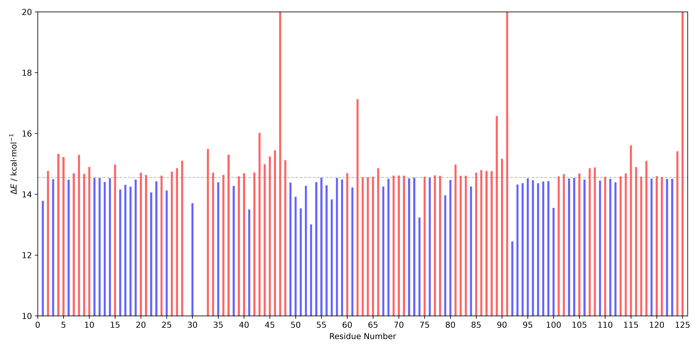
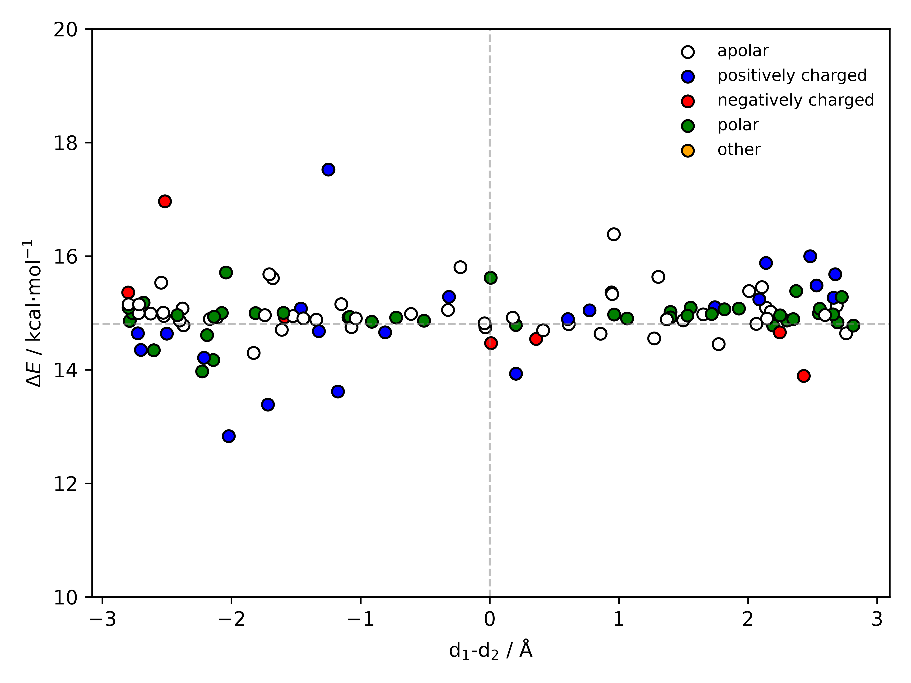

 

<h2>
 <b>Residue Deletion</b> 
 </h2>

<b>This protocol aims to assess the energy contribution of individual amino acid residues to the energy barrier of a specified reaction. This is accomplished by performing single-point calculations on both the reactant and transition state structures, each with a specific residue omitted.</b>

<b>The protocol requires the following inputs:</b>
 
● File listing the residues to be deleted
 
● Topology file in *prmtop format
 
● Reactant and transition state structures in *pdb format
 
● CP2K input template
 
● Selection of the QM region
 
 
<b>Additionally, the following software packages are needed:</b>
 
● CP2K
 
● VMD
 
● CPPTRAJ and ParmEd (from AmberTools)
 
● Python 3 with Matplotlib (for the plots)

---

 
<h2> 
 <b>I - Input Preparation </b> 
</h2>

 

To properly construct the QM system, a selection in the format of qm_selection.dat is required. The selection is written in terms of residue numbers, residue names and atom names, because atom numbers change upon residue deletion (the scripts renumber the residues that come after a deleted one). The <a href="https://arvpinto.github.io/enzyme_mutagenesis_cp2k/scripts/qmmm_mut_tools.py" target="_blank">qmmm_mut_tools.py</a> script writes the selection from the atoms of the QM layer, given either as an AMBER mask or as a list of atom numbers:

<pre style="color: white; background-color: black;">
# from an AMBER mask
user@machine:~$ qmmm_mut_tools.py make-selection -p hpla2_ee.prmtop -m ':47,48,128|:91&amp;!@N,H,CA,HA,C,O' -o qm_selection.dat
# from a file with the VMD indexes of the QM atoms (0-based, hence --zero-based; omit it for serial numbers)
user@machine:~$ qmmm_mut_tools.py make-selection -p hpla2_ee.prmtop -s qm_indexes.dat --zero-based -o qm_selection.dat
# check that an existing selection matches the topology
user@machine:~$ qmmm_mut_tools.py check-selection -p hpla2_ee.prmtop -q qm_selection.dat
</pre>

The QM/MM boundary should only cut C-C single bonds. Residues that are split by the boundary are expected to have an integer charge on their MM atoms, as in the sample topology (<code>qmmm_mut_tools.py rebalance</code> spreads the residual charge over the MM atoms of each split residue if that is not the case).

 

The <a href="https://arvpinto.github.io/enzyme_mutagenesis_cp2k/scripts/del_res_qmmm_cp2k.sh" target="_blank">del_res_qmmm_cp2k.sh</a> script has the following usage:

<pre style="color: white; background-color: black;">
del_res_qmmm_cp2k.sh [options] &lt;residue_list&gt; &lt;topology&gt; &lt;reactant_structure&gt; &lt;ts_structure&gt; &lt;cp2k_template&gt; &lt;qm_selection&gt;

user@machine:~$ del_res_qmmm_cp2k.sh deletion_list.dat hpla2_ee.prmtop R.pdb TS.pdb cp2k_template.inp qm_selection.dat
</pre>

 The script creates a directory for each residue in the list, where the CP2K input files will be generated, and a WT directory with the single-points of the unmodified system, so that the reference energy barrier is calculated with exactly the same settings. It processes the provided topology and structures using CPPTRAJ to remove the specified residues. To maintain the QM/MM configuration, the backbone of residues that are bonded to the QM layer is preserved while only their sidechains are deleted. If the CA atom is part of the QM layer, the CB atom is kept without charge and Lennard-Jones parameters to host the link atom, and the residual charge of the remaining MM backbone atoms is spread over them to keep an integer MM charge (<code>--no-rebalance</code> turns this off). Residues that cannot be removed without leaving broken bonds in the QM layer (GLY and PRO residues bonded to the QM layer, or parts of the substrate) are skipped, and should be addressed with the <a href="https://arvpinto.github.io/enzyme_mutagenesis_cp2k/mutagenesis_scan.html" target="_blank">mutagenesis scan</a> protocol instead. The deletion_summary.dat file reports what was done to each residue. Since residue deletion alters atom numbering, the QM/MM settings must be updated accordingly after each deletion. The <a href="https://arvpinto.github.io/enzyme_mutagenesis_cp2k/scripts/vmd_forceeval.tcl" target="_blank">vmd_forceeval.tcl</a> script is called within the latter to produce a file with the configuration of the QM layer, defined by the selection in the qm_selection.dat file. The resulting QM layer is then checked against the topology (link atoms, charge, number of electrons), and no inputs are written for a residue that fails these checks. 

 Note that residues that belong to the QM layer or take part in the reaction can be included in the list, but the transition state geometry loses its meaning once a catalytic residue is removed, so their energy barriers should not be interpreted as contributions. 

 

The calculations can then be run using a for loop:
<pre style="color: white; background-color: black;">
user@machine:~$ for i in WT RES_*; do cd "$i" ; cp2k.popt -i sp_res_R.inp -o sp_res_R.out ; cp2k.popt -i sp_res_TS.inp -o sp_res_TS.out ; cd .. ; done
</pre>

 

<h2> 
 <b>II - Output Processing</b> 
</h2>

 

After running the single-point calculations, the <a href="https://arvpinto.github.io/enzyme_mutagenesis_cp2k/scripts/extract_barriers.py" target="_blank">extract_barriers.py</a> script extracts the absolute energies and calculates the R->TS energy barrier for each residue deletion and for the unmodified system. Calculations that did not finish or whose SCF did not converge are reported and left out:

<pre style="color: white; background-color: black;">
user@machine:~$ extract_barriers.py --wt-dir WT -o energy_differences_del.dat RES_*
</pre>

 

The energy barriers can be plotted with the <a href="https://arvpinto.github.io/enzyme_mutagenesis_cp2k/scripts/E_diff_bar_plot.py" target="_blank">E_diff_bar_plot.py</a> script (the plots are saved at 600 dpi; see the <code>-h</code> option of each script for the available options):

<pre style="color: white; background-color: black;">
user@machine:~$ E_diff_bar_plot.py energy_differences_del.dat --ymin 10 --ymax 20
</pre>

    

 The calculated energy barriers upon deletion can be compared with the original energy barrier (14.8 kcal⋅mol-1, dashed line) to see if the residues are stabilizing or destabilizing to the transition state of the reaction step. A higher energy barrier upon deletion (red) means that the residue stabilizes the transition state relative to the reactant, while a lower one (blue) means that it is destabilizing. Here, we can see that the deletion of most residues is unfavorable, however, there are many residues whose deletion decreases the energy barrier associated with the TS. Most differences are of a few tenths of kcal⋅mol-1, so only the larger ones should be considered when selecting residues. 

 

For reactions involving charge separation, it might be useful to represent the residues relative to the separation plane that characterizes the macrodipole induced by the enzyme. This can be done with the <a href="https://arvpinto.github.io/enzyme_mutagenesis_cp2k/scripts/E_diff_dist_plot.py" target="_blank">E_diff_dist_plot.py</a> script, which takes the serial numbers (starting at 1) of the two atoms that represent the positive charge followed by the two that represent the negative charge:

<pre style="color: white; background-color: black;">
user@machine:~$ E_diff_dist_plot.py TS.pdb energy_differences_del.dat 684 34856 1982 34854 --ymin 10 --ymax 20
</pre>

    

 The script plots the calculated energy barriers against d1-d2, where d1 is the distance between the center of geometry of the deleted residue and the midpoint between the atoms that represent the direction of the positive charge, and d2 is the distance between the center of geometry of the deleted residue and the midpoint between the atoms that represent the direction of the negative charge. In principle, this approach can accurately capture and quantify the electrostatic contribution of residues to the transition state. Usually, negatively charged residues close to the positive moiety stabilize the transition state, while positively charged residues are destabilizing (and vice-versa relative to the negatively charged moiety). Note that the electric field induced by enzymes can be quite complex and these assumptions might not always hold. Suppose that a positively charged residue is close to the positive charge, but stabilizing the negative charges of two chemical groups nearby, the repulsion that arises from the lack of neutralizing positive charge may increase the energy barrier instead. In any case, when discussing this type of result, the environment of the specific residues should be taken into account. 

 
